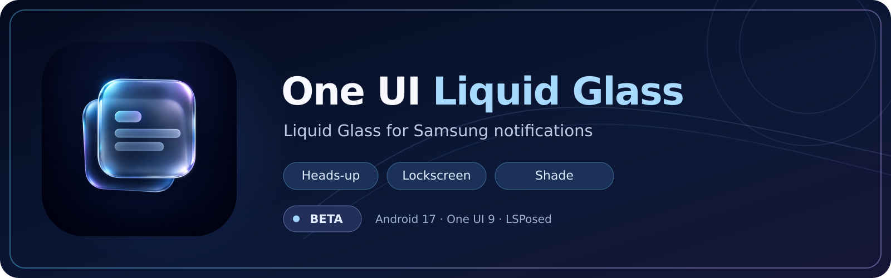

<p align="center">
  
</p>

<p align="center">
  
  
  
  
  <a href="https://github.com/igorcv88/OneUILiquidGlass/actions/workflows/release.yml"></a>
  <a href="https://github.com/igorcv88/OneUILiquidGlass/releases/latest"></a>
  <a href="https://github.com/igorcv88/OneUILiquidGlass/releases"></a>
  <a href="https://github.com/igorcv88/OneUILiquidGlass/stargazers"></a>
  <a href="https://github.com/igorcv88/OneUILiquidGlass/network/members"></a>
  <a href="LICENSE"></a>
</p>

<p align="center">
  <strong>Glass material, optical edges and optional compositor refraction for Samsung SystemUI notifications.</strong>
</p>

One UI Liquid Glass is an independent **LSPosed module** for Samsung's notification surfaces: detailed heads-up pop-ups, lockscreen notification cards and the expanded notification shade. It preserves SystemUI's native content and interaction while changing the cards' backdrop and glass material. Brief/Edge Lighting pop-ups and the music player are outside the current scope.

The release is a single APK:

- **LSPosed module:** hooks SystemUI, composes the glass material and edge lighting, and draws live backdrop blur. It works without the SurfaceFlinger add-on.
- **Optional SurfaceFlinger live lens:** the APK carries an injector and a compositor library (`assets/sfhook/`) that load into a freshly restarted SurfaceFlinger with `ptrace`, without a mount, a patched binary or a change to `/system`, for live edge refraction on the supported firmware. Root (KernelSU) is required for it; nothing persists past a reboot. See [docs/sf-live-app.md](docs/sf-live-app.md).

> [!IMPORTANT]
> This is an experimental module for a specific Samsung firmware family, **not a general-purpose Android theme**. It is not affiliated with Samsung or Google. Back up before enabling the optional SurfaceFlinger component, and follow the firmware and recovery requirements below.

## Project status

**Beta, controls panel under review.** The APK includes searchable typed controls, synthetic previews, independent surface switches, reversible presets and real test notifications with actions. The SurfaceFlinger button uses the bundled SfLive helper: status → install/selftest → explicit restart confirmation. Native parameters remain manual/pending recompilation; see [implementation and device-QA status](docs/CONTROLS_IMPLEMENTATION_2026-10-26.md).

A grouped settings interface with per-surface previews, switches and a realistic expanded test notification is **planned**, not yet implemented. See the [UI refactor handoff](docs/HANDOFF_APP_REFACTOR_2026-10-26.md) and the [full property catalog](docs/PROPERTY_CATALOG_2026-10-26.md) for the implementation contract.

## Features

| Surface | Current rendering |
| --- | --- |
| **Detailed heads-up** | Live blur, edge lighting and a motion-gated captured lens band in APK-only mode; optional compositor lens and layered blur with the KernelSU add-on |
| **Lockscreen** | Blur attached to the card geometry, independent light/dark material, compositor profile when installed; optional glass treatment for the notification overflow pill |
| **Expanded shade** | Independent card blur, backdrop-dependent tone and text/icon adaptation, with controls to keep cards legible over light and dark content |
| **Diagnostics** | SystemUI lifecycle and material logs (`OULG`), optional performance/trace logging, compositor logs (`OULG_SF`) and safe fallbacks |

The optical material and the real refraction path are different. APK-only edge highlights simulate the look of a lens; only an eligible compositor shader or a captured sampled backdrop can actually displace content behind a card. The sampled band is motion-gated because capture latency can make moving content appear to trail the card.

## Requirements and compatibility

- Tested/developed for **Galaxy S25 Ultra SM-S938B**, Android 17 / **One UI 9**. Development was based on `S938BXXUCZZIC`; `S938BXXUCDZIF` is recognized by the optional installer, but matching framework files do **not** substitute for physical APK validation.
- **LSPosed API 93+**, with scope limited to **System UI** (`com.android.systemui`).
- **Detailed** notification pop-up style. Brief pop-ups/Edge Lighting are not hooked.
- **Optional compositor lens only:** root (KernelSU); the firmware fingerprint must be on [the live allowlist](sfhook/live/allowed_fingerprints) (S938BXXUCDZIF). It injects code into SurfaceFlinger and restarts the userspace; it can affect system stability and integrity-sensitive configurations.

The legacy KernelSU module (`sfhook/module/`, a patched SurfaceFlinger mounted through an overlay metamodule) is no longer published.

## Installation

Download the binaries only from [GitHub Releases](https://github.com/igorcv88/OneUILiquidGlass/releases):

1. Install `OneUILiquidGlass-<version>.apk`.
2. Enable the module in LSPosed and scope it **only** to System UI.
3. Open the app, enable **Experimental glass**, then restart SystemUI:

   ```sh
   su -c 'kill $(pidof com.android.systemui)'
   ```

4. Use the app's test-notification button to inspect the visual result. The current button schedules a BigText notification after five seconds; the proposed larger test with action buttons is described in the handoff.

For the **optional compositor refraction**, the app installs the bundled binaries, runs a self-test in a throwaway process and then restarts the userspace with the library loaded into SurfaceFlinger (root helper `oulg-live.sh`, [docs/sf-live-app.md](docs/sf-live-app.md)). It is redone after every reboot.

You can verify that the native library loaded with:

```sh
su -c 'logcat -d -s OULG_SF | head'
```

`LOADED` means the library was injected; shader rewrite activity is logged after an eligible pop-up or lockscreen card is drawn. A loaded library alone does not prove that the specific card's shader was rewritten.

## Tuning and previews

Today, most controls are **live SystemUI properties** refreshed about once per second:

```sh
su -c 'setprop debug.oulg.liveoptics 0.5'
su -c 'setprop debug.oulg.liverim 2'
su -c 'setprop debug.oulg.lensgate directional'
```

`debug.*` overrides reset at reboot unless restored separately. Most `debug.oulg.sf.*` shader parameters are read **only when a shader compiles**: changing their property does not change already compiled shaders. Clearing the shader cache or restarting SurfaceFlinger is a separate, higher-risk operation. The app must never present a value as applied when the compositor is still running the previous shader.

Some examples from the **current code defaults** (not necessarily the effective overrides on a running phone):

| Property | Default | Effect |
| --- | --- | --- |
| `liveblur` / `sfrefract` | 1 / 0 | APK-only live material vs optional compositor lens |
| `liveradius` / `liveshaderadius` | 80 / 120 px | Blur for pop-up/lockscreen vs expanded shade |
| `liveoptics` / `liverim` | 1 / 2 | APK-only optical gain vs heads-up outer contour |
| `liveglint` / `shadeglint` | 0.10 / 0.10 | Internal corner glint on pop-up/shade |
| `lensgate` / `lenssettle` | directional / 100 ms | Motion gate for captured lens |
| `sflens` / `kglens` | 0.45 / 0.40 | Lens strength per compositor profile |
| `shadetone` / `veilmax` | 3 / 0.25 | Adaptive shade tone and veil limit |
| `lightglass` / `shadelightglass` | 0.75 / 0.27 | Light material opacity on pop-up vs shade |
| `sf.core` / `sf.kgcore` | 48 / 80 px | Shader body blur profile parameters; compilation-time |

The lockscreen compositor now uses a continuous glass-to-core blur gradient (live bundle v0.22), with a 52 px effective core and unchanged outer contour. See [tuning and reference comparison](docs/lockscreen-gradient.md).

The [property catalog](docs/PROPERTY_CATALOG_2026-10-26.md) enumerates every currently parsed setting, its default, domain and application phase. For engineering details, see [architecture](docs/architecture.md), [validation](docs/validation.md), [physical tests](docs/physical-test.md) and [optics handoff](docs/handoff.md).

## Troubleshooting and recovery

- **Disable the look:** turn off Experimental glass and restart SystemUI, or disable the APK in LSPosed.
- **No heads-up:** verify Detailed pop-up mode, channel importance, notification permission and Do Not Disturb before treating it as a hook failure.
- **Blur fallback:** find `BLUR_DRAWABLE_FALLBACK`, `DECISION`, `TUNING` in `logcat -s OULG`.
- **Diagnostics:** set `debug.oulg.trace=1` for extra traces; `debug.oulg.perf=1` enables hook timings. Turn them off after testing.
- **Compositor failure:** a reboot always returns to the stock SurfaceFlinger; the live lens is never loaded at boot.
- **Uninstall:** run the helper's `uninstall` (from the app) and reboot before uninstalling the APK.

## Build and release

**APK:** JDK 17, Android SDK 36.

```sh
./gradlew testDebugUnitTest lintDebug assembleDebug
```

**SurfaceFlinger live bundle:** Android NDK r29 (`29.0.14206865`). Run before Gradle so the APK carries `assets/sfhook/`; a build without it works, with the feature unavailable.

```sh
ANDROID_NDK=/path/to/ndk sfhook/build.sh
sh sfhook/tools/live_check.sh
```

For a shader rewrite check, compile `sfhook/tools/refract_check.c` and validate generated `mod_*` shader files with `glslangValidator`.

The [release workflow](.github/workflows/release.yml) is dispatched manually on `main`; a change to `.github/release-trigger` on `main` can dispatch it through the [trigger workflow](.github/workflows/trigger-release.yml). It tags `v0.1.N`, builds the SurfaceFlinger live bundle, builds/tests/lints the APK (checking that it carries the bundle), signs it using repository secrets and publishes the APK as the only asset; its SHA-256 is in the release notes.

## Repository layout

- `app/`: LSPosed module, `MainActivity`, config provider, notification hooks, optics and live property parser (`glass/Tuning.java`).
- `sfhook/`: compositor library and shader rewrite, the `ptrace` injector (`inject.c`), the live bundle's root helper and version (`live/`), and the legacy KernelSU module (`module/`, unpublished).
- `docs/`: architecture, design handoff, property catalog, validation and previous investigations.
- `.github/assets/`: project icon and banner.

## License and attribution

MIT License. See [LICENSE](LICENSE) and [NOTICE](NOTICE). Independent SystemUI project; the WaEnhancer Community design and README organization informed this project's documentation, but the projects do not share a runtime or settings storage.
