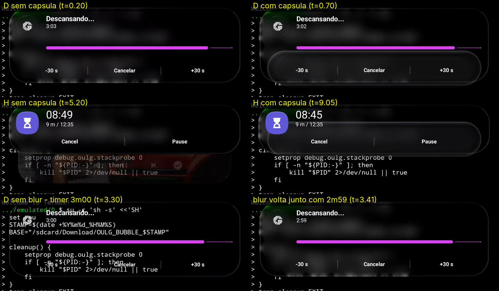

# OneUILiquidGlass — Parecer independente sobre o laudo do PR #147 (cápsula tardia e entrada do blur)

Data: 4 de novembro de 2026. Firmware: Galaxy S25 Ultra DZIF. Escopo: diagnóstico. Nenhum código de produção foi alterado.

Material reexaminado:

- `OULG_BUBBLE_20261104_122645.mp4`: 1440 × 3120, 977 quadros, 9,901 s.
- `OULG_BUBBLE_20261104_122645.log`: 8.543 linhas.
- Código em `main` após o merge do #147 (`7e78c38`).
- Histórico dos merges #130–#147.
- Laudo `OULG_LAUDO_PR147_CAPSULA_BLUR_2026-11-04.md`.

Convenção usada aqui: **[V]** indica observação verificada diretamente em pixels, log ou código. **[I]** indica inferência a partir de [V]. **[H]** indica hipótese ainda não testada. **[F]** indica informação que falta.

---

## 0. Resumo

1. **Cápsula.** A geometria medida nos pixels não corresponde a nenhuma superfície registrada pela telemetria atual.
   - A forma tem tamanho fixo: ~1232 × 200 px, raio ≈ 100 px.
   - A borda inferior fica sempre ~12 px **abaixo** da borda inferior do cartão da frente, qualquer que seja esse cartão (438 px ou 288 px).
   - A forma surge ~0,40–0,45 s depois que o cartão assenta e some no início do swipe seguinte.
   - Esses fatos contrariam H1 (material do outro cartão), H2 (sombra/fundo do `stack_pip_layout`) e H3 (ripple/máscara de `action0`) como produtores dos pixels.
   - Proponho **H6**: o produtor é uma view ou um desenho **fora dos filhos do `CardStackView`**. O candidato mais provável é o "indicador de pilha" nativo, irmão do stack em `ongoing_card_stack_and_shadow_layout`.
   - No visual nativo, o cartão da frente é opaco e esconde esse indicador, exceto pela faixa de ~12 px abaixo dele. Com o vidro translúcido, o indicador inteiro fica visível.
   - Nenhuma telemetria do projeto jamais percorreu esses irmãos, e nenhum PR (#132–#145) atuou sobre eles. Isso explica por que todas as correções anteriores falharam.
   - Status: **inferência forte, não observada diretamente**. O experimento E1 (read-only) confirma ou refuta.
2. **Blur que entra depois.** É independente da cápsula.
   - Em 6 episódios com o cartão D na frente, só **um** mostra o cartão sem blur e sem tint (~0,17–0,3 s). É também o único em que o último `draw()` do host antes de vir para a frente ocorreu com `regionAlpha=0` exato. O blur volta **no mesmo quadro** em que o timer muda de 3:00 para 2:59, ou seja, num redesenho causado por atualização de conteúdo.
   - Mecanismo candidato (**M2**): um `BackgroundBlurDrawable` desenhado com alpha 0 não grava seu `RenderNode`. O fade posterior via `setAlpha` não invalida o host, porque `LiveGlass.fade()` ignora o retorno de `setRegionFade`.
   - Contraprova parcial: dois episódios H com o mesmo padrão Java mostraram blur normal.
   - Status: **plausível, não confirmado**. O experimento E3 discrimina.
3. **Sincronização vídeo/log.** É possível com precisão de ~±0,1 s, ao contrário do que o laudo afirma, usando as 18 trocas de cartão como âncoras (offset: vídeo t=0 ≈ log epoch `1793806007.26`). Não é possível com precisão de milissegundos.

*Quadros do MP4 (recorte y=110–670, escala 0,5). A cápsula aparece com D (438 px) e com H (288 px), sempre com a mesma largura e ultrapassando a borda inferior do cartão. Na linha de baixo, o cartão D aparece sem blur com o timer em 3:00, e o blur volta no quadro em que o timer passa a 2:59.*

---

## 1. Método e limites

### 1.1 Sincronização [V]

- Classifiquei o cartão da frente em cada quadro pela assinatura de cor: barra magenta = "Descansando" (D, 438 px), ícone roxo de ampulheta = timer (H, 288 px), restante = mídia (M, 450 px). Isso gera 18 trocas de cartão no vídeo.
- No log, o cartão da frente em cada tick é o `stack_pip_layout` em x≤58, y≤175, `alpha>0,9`. A altura identifica D/H/M.
- A busca de offset por mínimos erros entre trocas homólogas resulta em **vídeo t=0 ↔ epoch 1793806007,26**. O erro acumulado é de 1,39 s em 18 trocas, com a maioria abaixo de 0,1 s e o pior caso em ~0,23 s.
- O vídeo cobre o log de ≈7,26 a ≈17,16. Os marcadores `BEGIN/END_BUBBLE_CAPTURE` não delimitam o vídeo: o `screenrecord` começou ~0,65 s depois do `BEGIN`, e o `END` foi registrado ~5 s depois do último quadro.
- Âncora fina adicional: a mudança do texto do timer, que ocorre a cada 1 s.

**Limite [F]:** não há um evento comum a pixels e log. Tudo abaixo de ~0,1 s é indicativo. Os eventos Java também não equivalem a quadros: uma animação de propriedades do `RenderNode`, como translação ou escala do pai, não chama `LiveGlassDrawable.draw()`. A ausência de `DRAW_*` não significa ausência de quadro.

### 1.2 Medidas em pixels [V]

As medições foram feitas no MP4 em resolução nativa, com perfis de luminância em colunas e linhas fixas. Os valores abaixo são de luminância de 0 a 255.

---

## 2. Cápsula

### 2.1 Observações verificadas

| | D na frente (t=0,70 s) | H na frente (t=9,05 s) |
|---|---|---|
| Cartão da frente (log) | `stack_pip_layout` 1340×438 em (50,152) → base y≈590 | 1340×288 em (50,152) → base y≈440 |
| Cápsula, x | 103–1337 | 104–1336 |
| Cápsula, y | ≈402–604 (aro superior em 404) | ≈252–454 (aro superior em 254) |
| Altura / largura | ~200 / ~1232 | ~200 / ~1232 |
| Base da cápsula − base do cartão | ≈ +12 a +14 px | ≈ +12 px |
| Raio aparente | ≈ 96–100 (pílula completa) | idem |

- **[V]** A largura de 1232 px = 0,919 × 1340 coincide com a escala de um cartão "de trás" (x=104 no log). O raio ≈ 0,92 × 108, que é o raio nativo do cartão.
- **[V]** A cápsula **ultrapassa a borda inferior** do cartão da frente. Em x=720 com D na frente: aro do cartão em y≈580–584, aro da cápsula em ≈596–600, fim em ≈604.
- **[V]** O texto dos botões está nítido por cima da cápsula. Por isso, a cápsula está abaixo do conteúdo do cartão da frente na composição.
- **[V]** A cápsula **não aparece em todos os episódios**. Ela surge ≈0,40–0,45 s depois que um cartão assenta na frente: D 0,06→0,44 s; D 7,62→8,03 s; H 4,96→5,39 s; H 8,62→9,0 s. A entrada leva ~50–80 ms. A cápsula some no começo do próximo swipe. Em episódios com menos de ~0,4 s (D 1,99–2,38; D 3,07–3,48; D 4,17–4,61; D 6,15–6,60) ela não chega a aparecer.

### 2.2 Confronto com o log

- **[V]** Os cartões de trás no estado assentado têm `stack_pip_layout alpha=0.0`. A região própria deles faz fade até `regionAlpha=0`: por exemplo, `3bcd243` no burst 2, de 240 → 0 entre +41 e +228 ms. No hwui, um `RenderNode` com alpha ≤ 0 é tratado como `nothingToDraw` e não emite conteúdo nem sombra.
- **[V]** As regiões próprias registradas (`regionBounds`) são sempre o retângulo inteiro do cartão: 1340×438, 1340×288 ou 1340×450. Nenhuma tem ~218 px de altura.
- **[V]** O instante em que a cápsula surge coincide (±0,1 s) com ticks sem nenhuma mudança nos nós instrumentados:
  - burst 9, tick 352/480 ms: `emitted=0`;
  - burst 14, tick 481 ms: `emitted=0`;
  - burst 2: a cápsula surge ≈ +516–566 ms, logo depois do `LIVE_STACK_TIMELINE_DONE` (520 ms). A janela atual termina justamente quando o fenômeno começa.
- **[V]** `CoveredFill` no `stack_pip_layout` aparece em 122 dos 136 registros de **um único objeto**, `457c2c7`, o cartão de mídia, cujo fundo nativo é `GradientDrawable fill=ff633f00`. Os outros 14 vêm da expansão inicial (burst 1). Não se trata de uma alternância Ripple↔CoveredFill no mesmo frame. `CoveredFill.getOutline()` define alpha 0, então esse frame não projeta sombra, quaisquer que sejam `shadowA/shadowS`.
- **[V]** Instrumentação existente:
  - `LiveStackTimeline` percorre somente `stack.getChildAt(i)` (`LiveStackTimeline.java:119`);
  - `Probe.liveSurfaceTree` lista só ancestrais e descendentes do cartão (`Probe.java:150`);
  - `WindowSurvey` só roda com `debug.oulg.trace=1`, para janelas EdgeLighting/HeadsUp/Popup, e deduplica por `profundidade:classe`;
  - `LiveCardHooks.regionTint` para no `CardStackView` (`LiveCardHooks.java:269`).

  **Nenhum caminho do módulo lê ou altera os irmãos do `CardStackView`.**
- **[V]** A cadeia de ancestrais registrada em `LIVE_DETAIL_NODE` é `CardStackView` (1340×altura do cartão) → `LinearLayout id=ongoing_card_stack_and_shadow_layout` (1340×3120) → `OngoingCardBackgroundContainer` → `FrameLayout` → `parentPanel`. A altura do `CardStackView` acompanha a do cartão da frente (438 ou 288).

### 2.3 Avaliação das hipóteses do laudo

| Hipótese | Veredito | Fundamento |
|---|---|---|
| H1 — região de vidro de outro cartão sobreposta ou defasada | **Contrariada como produtora dos pixels** | Altura fixa ~200 px; o cartão de trás teria 265/403/414 px na escala 0,919. Cartão de trás com alpha 0 e região em alpha 0 no estado assentado. Nenhuma região de ~218 px. A entrada da cápsula não coincide com `BLUR_*` nem `REGION_FADE`. |
| H2 — fundo/sombra nativos do `stack_pip_layout` durante rebind | **Contrariada** | O frame da frente tem `clip=true`. Nada dele pinta abaixo de y=590, mas a cápsula vai até ~604. A largura de 1232 ≠ 1340. O frame de trás tem alpha 0. A "alternância" `CoveredFill` é, na verdade, o cartão de mídia, cujo outline tem alpha 0 e por isso não projeta sombra. |
| H3 — componente de ação | **Contrariada** | É uma única forma de 1232 px cobrindo os três `action0` (422×144 cada, y 446–590), dentro do clip do frame. A forma é idêntica com os dois botões `ongoing_action_text_button` do cartão H, que têm outra geometria. Também ultrapassa a base do cartão. |
| H4 — composição assíncrona | **Contrariada como produtora**; não excluída como modulador | O SurfaceFlinger não cria uma forma de 1232×200 que nenhuma região descreve. A latência do compositor pode afetar *quando* a cápsula aparece, mas não *o que* ela é. |
| H5 — interação | Não necessária para a cápsula | A cápsula e o blur tardio têm assinaturas temporais distintas (§3). |

### 2.4 Hipótese nova — H6: produtor fora do `CardStackView`

**[I]** As propriedades medidas em §2.1 descrevem uma view (ou um desenho direto em canvas) com estas características:

- tem tamanho fixo e é estreitada como um cartão "de trás";
- é posicionada em função da **altura do `CardStackView`**: base = base do stack + ~12 px. Isso é coerente com um filho posterior de um `LinearLayout` vertical (`ongoing_card_stack_and_shadow_layout`) com margem negativa;
- tem Z menor que o do stack (`CardStackView elev=3`), por isso fica atrás dos cartões;
- existe só com mais de um item;
- recebe uma animação de entrada com atraso de ~0,4 s depois do assentamento e é escondida no início do swipe.

Esse é o padrão de um "indicador de pilha": a borda do cartão seguinte espiando por baixo do cartão da frente. No visual nativo, o cartão da frente é opaco e só a faixa de ~12 px é visível. Com o material translúcido, a forma inteira aparece através dele, o que se percebe como uma "cápsula atrás dos botões".

O que **não** foi observado [F]:

- a classe, o ID e o drawable do produtor;
- se ele é uma view irmã, um filho de `OngoingCardBackgroundContainer` ou um desenho em `CardStackView.dispatchDraw`;
- a origem do aro claro;
- o mecanismo do atraso de ~0,4 s.

H6 é a única hipótese, entre as examinadas, compatível com **todas** as medidas de §2.1. Isso, porém, ainda não é uma atribuição.

---

## 3. Sintoma secundário: superfície transparente antes do blur

### 3.1 Observações [V]

- Episódios com D na frente (vídeo → log, offset 7,26): 0,06–1,03; 1,99–2,38; 3,07–3,48; 4,17–4,61; 6,15–6,60; 7,62–8,15.
- Só o episódio 3,07–3,48 mostra o cartão sem blur e sem tint: o texto do Termux fica nítido, com gradiente horizontal médio de 13,6 contra ~2 nos demais, e o aro continua visível. Duração ≈ 3,22–3,39 s.
- Último draw gravado do host D antes de ele vir para a frente, por episódio:

  | Episódio | Host | `regionAlpha` no draw |
  |---|---|---|
  | 1 | `e98b390` | 4 |
  | 2 | `a810682` | 35 |
  | **3 (sem blur)** | **`88afb0c`** | **0** |
  | 4 | `14266ec` | 38 |
  | 5 | `96bfa52` | 6 |
  | 6 | `3dd34c7` | 30 |

- Sequência do host `88afb0c`, toda dentro da janela armada do burst 6:
  - `BLUR_ASSIGNED` em 10,136;
  - `REGION_FADE`→0 em 10,141;
  - `BLUR_UPDATED` + `DRAW_OWN_REGION` com `regionAlpha=0` em 10,160;
  - `REGION_FADE` 0,26→1,0 entre 10,167 e 10,203, **sem novo draw**;
  - próximo `DRAW_OWN_REGION` só em 10,546.
- O blur volta no mesmo quadro em que o texto do timer muda de 3:00 para 2:59, ou seja, num redesenho provocado pela atualização da notificação. Usando essa âncora, o draw de 10,546 corresponde a vídeo ≈3,40.
- **Contraprova [V]:** `96bfa52` (14,223) e `3dd34c7` (15,729) também foram desenhados com `regionAlpha=0`, fizeram fade até 255 sem draw registrado e viraram o cartão H da frente. Nos quadros correspondentes (7,15–7,50 s e 8,64–8,85 s), o cartão H mostra blur normal, com gradiente ~2,5.
  - Para `3dd34c7`, o trace estava armado durante todo o intervalo.
  - Para `96bfa52`, há uma lacuna sem trace entre 14,35 e 14,52.

### 3.2 Mecanismo candidato M2 [H]

Na implementação AOSP de `BackgroundBlurDrawable`, `draw()` retorna sem `drawRenderNode` quando `getAlpha()==0`. Sem esse `RenderNode` na display list, não há `positionChanged` no RenderThread, e portanto nem região nem tint. Além disso, `setAlpha()` chama `invalidateSelf()`, mas o drawable de blur não tem callback (`BackgroundBlurBridge`: "the drawable has no callback of its own").

No módulo:

- `LiveGlass.fade()` (`LiveGlass.java:579`) chama `setRegionFade` e **descarta o retorno**. O `invalidate()` só ocorre quando `showsGlass()` muda (`:499`, `:522`).
- `HeadsUpHooks` faz o contrário (`HeadsUpHooks.java:2052`, `:2061`): `if (bridge.setRegionFade(...)) v.invalidate()`.

Assim, um host desenhado com alpha 0 permanece sem região até o próximo redesenho, que pode vir de uma atualização de conteúdo.

Pendências [F]:

- confirmar o código DZIF de `BackgroundBlurDrawable.draw()`;
- explicar por que os dois casos H não reproduzem o efeito. Possibilidades: redesenho não instrumentado, como o tick de 1 s do timer H invalidando o host; implementação diferente; ou outro fator;
- a telemetria não lê `mRect` (posicionamento) da **própria** região. Ela lê isso apenas para o drawable Samsung, como `positioned=` em `LIVE_RENDER_CARD`.

### 3.3 Correção ao laudo

- **[V]** No burst 1, `e98b390` (D) era o cartão **de trás**: `stack_pip_layout` em (104,193) com `alpha=0.0`, e H na frente em (50,152). O "alpha 0 por centenas de ms" do §2.2/§4 do laudo é o fade esperado de um cartão oculto, não uma entrada tardia de blur.
- **[V]** O burst 1 ocorre antes do início do vídeo (log 6,53 contra vídeo t=0 ≈ 7,26). Por isso, não pode ser relacionado a nenhum quadro.

---

## 4. Experimentos propostos

Todos ficam atrás de uma propriedade `debug.oulg.*` com padrão 0, que corresponde ao comportamento atual. Não alteram CHIP, Now Bar nem notificações comuns. Não há merge automático.

### E1 — identificação do produtor da cápsula (read-only, decisivo para H6)

`debug.oulg.stackprobe=2`, extensão da timeline existente:

1. Em cada tick, percorrer também os filhos de `stack.getParent()` (`ongoing_card_stack_and_shadow_layout`), exceto o próprio stack, e os filhos de `OngoingCardBackgroundContainer`, com profundidade ≤ 6 e ~40 nós. Registrar, só em mudança, o `describe()` atual mais `getZ()`, `getClipBounds()`, a classe e o `getOutline()` do provider, além de bounds, alpha e cor do drawable.
2. Uma única vez por processo, listar por reflexão os métodos declarados por `CardStackView` cujo nome contenha `draw`, `shadow`, `peek`, `dummy` ou `behind`. Só nomes; nada é invocado.
3. Estender os ticks do burst até ~1200 ms (640, 800, 960, 1200), porque a cápsula surge entre ~0,4 e 0,56 s depois do início do burst, e a janela atual termina em 0,52 s.

Previsões:

- **H6 confirmado** se existir um nó fora do stack com tela ≈ [104, base_stack−188] → [1336, base_stack+12], cujo alpha ou visibilidade subam ~0,4 s depois do assentamento e caiam no começo do swipe.
- **H6 refutado como view** se nenhum nó tiver essa geometria e a cápsula continuar aparecendo. O próximo candidato passa a ser desenho direto no canvas do `CardStackView`, investigado pelo item 2.

Controles:

- negativo: uma live update sozinha. O nó deve estar ausente ou com alpha 0.
- positivos: duas live updates; live + mídia.

### E2 — atribuição dos pixels (A/B reversível, um único produtor)

Só depois de E1 identificar o nó por **resource name exato**, nunca por heurística de forma.

`debug.oulg.stackshadow`:

- `0`: nativo.
- `1`: aplicar ao drawable **desse nó** um `ColorFilter` magenta (`SRC_IN`), salvando e restaurando o filtro original. Isso não oculta nada nem altera outline, clip ou toque. Se a cápsula ficar magenta no vídeo, a atribuição é inequívoca.
- `2`: suprimir só o desenho do fundo desse nó com um wrapper que delega geometria, estado e outline **com o alpha nativo**. Não usar `setAlpha`, `setVisibility` nem outline com alpha 0, porque o #132/#134 mostrou o risco quando a view recorta conteúdo.

Critérios:

- com `1`, a cápsula muda de cor em D e em H, e a faixa de ~12 px abaixo do cartão também;
- com `2`, a cápsula some e conteúdo, botões, clip e o blur dos cartões ficam inalterados;
- com uma só live update, nenhum dos modos produz diferença visível.

### E3 — blur tardio (independente)

1. Telemetria read-only (`stackprobe=2`): em cada tick, ler da **própria** região (`BackgroundBlurBridge.drawable`) `mRect`, `isVisible()`, `getAlpha()` e `mBlurRadius`. Incluir também um contador de chamadas de `LiveGlassDrawable.draw()` por host entre ticks, como número e não como linha.
   - Previsão M2: no episódio sem blur, `mRect` fica vazio ou desatualizado enquanto `alpha=255`, até o próximo draw.
2. A/B `debug.oulg.fadeinval=1`: em `LiveGlass.fade()`, chamar `v.invalidate()` quando `setRegionFade` retornar `true` **e** a região tiver passado de alpha 0 para maior que 0. Isso replica o padrão de `HeadsUpHooks`. É uma invalidação por transição, não por frame.
   - Previsão M2: os episódios "transparente → blur" desaparecem.
   - Controle: a cápsula não muda. Se mudar, M2 e H6 não são independentes.
   - Risco: um redesenho a mais por transição 0→>0, sem loop, porque o `fade` só retorna `true` em mudança maior que 0,004.

Protocolo de captura: o mesmo do `docs/live-stack-draw-region-diagnostics.md`, com swipes **lentos e com pausas de mais de 1 s** em cada cartão, para que a cápsula chegue a aparecer em todos os episódios.

---

## 5. Opções de correção (não implementadas; só após E1/E2)

| Opção | Efeito | Riscos |
|---|---|---|
| A. Recortar o indicador nativo para fora da área do cartão da frente (`setClipBounds` atualizado em pre-draw) | Mantém a faixa de ~12 px, que é a affordance de pilha, e elimina a parte vista através do vidro | O clip precisa seguir a altura do stack em cada frame do swipe. Com um frame de defasagem pode surgir uma fresta. Requer restauração exata. |
| B. Suprimir o desenho do indicador enquanto o vidro estiver ativo | É o mais simples e elimina a cápsula | Perde a indicação visual de mais de um cartão. É uma decisão de UX. |
| C. Aplicar material de vidro ao indicador | Mantém a coerência visual | **Desaconselhado**: ele continuaria visível através do cartão da frente, agora como vidro sobre vidro, com uma terceira região de blur. |

A escolha entre A e B é de produto. A opção A preserva a semântica nativa; a B tem menor superfície de erro.

---

## 6. Pontos de concordância e divergência com o laudo

| Laudo | Este parecer |
|---|---|
| §1: não é possível alinhar vídeo e log | Possível com ~±0,1 s pelas trocas de cartão (offset 7,26 s) e com âncora mais fina pelo tick do timer. Continua impossível com precisão de milissegundos. **Divergência parcial.** |
| §2.2: dois hosts com fades defasados podem contribuir para a entrada tardia | No burst 1, o host de 438 px era o cartão de trás (alpha 0): comportamento esperado, fora do vídeo. **Divergência.** |
| §2.3: alternância Ripple→CoveredFill→Ripple | 122/136 `CoveredFill` pertencem ao frame do cartão de mídia, e os demais à expansão inicial. Não há alternância por frame no mesmo cartão. Sem sombra, pois o outline tem alpha 0. **Divergência.** |
| §2.3: os fatos tornam insuficiente repetir alterações em botão/sombra | **Concordância**, e com fundamento adicional: o produtor está fora da área que essas alterações alcançam. |
| §3 H1–H5 | H1, H2 e H3 contrariadas como produtoras. H4 contrariada como produtora. H5 desnecessária. Acrescentada H6. |
| §4: não afirmar causa comum | **Concordância.** As assinaturas temporais são distintas. M2 é o candidato para o blur e H6 para a cápsula. |
| §6: experimento reversível, um produtor por vez | **Concordância**: E1 → E2, e E3 em separado. |

**Limitações deste parecer:**

- H6 e M2 são inferências. Nenhuma das duas foi observada diretamente.
- Há apenas uma captura, com um único fundo (Termux preto).
- O código DZIF de `CardStackView` e `BackgroundBlurDrawable` não foi inspecionado.
- Os dois casos H contradizem M2 e não estão explicados.

Este parecer deve ser revisto se E1 não encontrar o nó previsto.
