# Refatoração de UI/UX e auditoria funcional — 27/10/2026

Base: `main` em `f041c07` (após #61). Substitui a interface descrita em `PANEL_UX_2026-10-26.md` e
`CONTROLS_IMPLEMENTATION_2026-10-26.md`. O renderer (hooks, `glass/`, `sfhook/` C) **não foi alterado**;
a única mudança no lado privilegiado é o comando `setprops` do helper (lista fechada, ver abaixo).

## Decisões que mudam a experiência

1. **Início / Superfícies / Ajustes.** Diagnóstico deixou de ser destino da barra: é tarefa rara e técnica.
   Início responde "está ligado? funciona? como testo?" sem rolagem longa; Superfícies é onde se ajusta;
   Ajustes concentra o que é secundário (tema, lente dinâmica, testes extras, backup, diagnóstico,
   recuperação). Critério: frequência de uso e risco, não a arquitetura de classes.
2. **Controles principais dependem do modo real.** Com o vidro padrão (sem root) o pop-up mostra Desfoque,
   Escurecimento, Opacidade do vidro claro, Contorno e Reflexo; com a lente dinâmica mostra Refração da borda,
   Desfoque sob a lente, Opacidade e Contraste medido. Nunca se oferece como principal algo que o modo atual
   ignora.
3. **Controle inativo é desabilitado e explica em uma linha como ativá-lo.** O valor fica salvo. Quem quiser
   preparar o próximo modo abre o editor, que permite editar com o aviso "o valor fica salvo e passa a valer
   quando a condição for atendida".
4. **Nada afirma aplicação sem evidência.** Salvar não diz "aplicado". O estado global usa a confirmação de
   leitura do SystemUI ("lido pelo sistema"), que é leitura, não efeito visual. Valores do compositor ficam
   "pendentes" até um reinício confirmado.
5. **A prévia é um componente de comparação**: cenas distintas por superfície, quatro fundos com detalhe
   fino, segurar para ver "Antes", lupa que segue a parte afetada durante o arraste e trio Menos/Atual/Mais
   no editor. Ajustes sem representação útil dizem isso e oferecem testar no aparelho.
6. **Avisos únicos e contextuais.** No Início aparece no máximo um aviso, o mais importante, com ação:
   módulo não detectado, sistema sem resposta, lente não carregada, ajustes da lente pendentes ou valores
   alterados fora do app.

## Inventário anterior e defeitos encontrados

Evidência: código de `f041c07` e as cinco capturas enviadas. Cada item tem a correção desta mudança.

| # | Defeito (código anterior) | Correção |
| --- | --- | --- |
| D1 | `MainActivity.updateApplicationStatus` mostrava sempre `* N ajustes SF salvos · aplicação manual / recompilação`, cortado no topo | Aviso único no Início e na linha da lente, só no modo lente e só com valores realmente pendentes (`CompositorValues.pending`), com ação "Aplicar" |
| D2 | `ModulePanel` ("Refração dinâmica") no topo do Início e repetido em Diagnóstico, com texto de implementação | Folha "Lente dinâmica" em Ajustes: estado, um próximo passo, valores pendentes, manutenção só após root confirmado, detalhes técnicos recolhidos |
| D3 | `ControlLayout.application` + `SettingStatus.inactive` repetiam "Ao vivo · sem reinício da SystemUI", "padrão X" e "requer sfrefract=0" em toda linha | Linha = nome + valor + reset (só se diferente do padrão) + controle; status só quando acionável |
| D4 | `settingRow` mostrava "Não se aplica" mas o `SeekBar` continuava arrastável | `Slider` desenhado e bloqueado quando `Applicability` diz inativo/desligado |
| D5 | `saveInline` dizia "Salvo · enviado ao vivo para SystemUI" ao gravar a preferência | Sem alegação por linha; estado de sincronização baseado no ACK e rotulado como leitura |
| D6 | `render()` recriava toda a hierarquia a cada switch, navegação, favorito ou retorno do getprop (perda de scroll e foco, piscadas) | Páginas construídas uma vez; `bind()` incremental; mudança de tema/fonte/orientação reconstrói as views sem recriar a Activity e preserva destino, superfície e rolagem |
| D7 | `values()` só incluía flags gravadas explicitamente; `MaterialPreview.feature()` consultava a superfície que `focus()` podia ter trocado | `ControlState.shownMap()` inclui todas as flags com padrão; `PreviewParams.of(..., surface, ...)` recebe a superfície explícita; testes ON/OFF por superfície |
| D8 | `MaterialPreview.focus()` trocava superfície e tema da amostra silenciosamente | Removido; foco só posiciona a lupa |
| D9 | Mesmo cartão nas três superfícies, ~10 parâmetros pintados, faixa "Diagrama de domínio" para o resto | `NotificationPreview` + `PreviewParams` (ver abaixo) |
| D10 | Registry: `lens/profile/refract/ior/disp` dependiam de `backdrop=capture\|hybrid\|grid`, mas `GlassDrawable.drawLens` os usa na faixa de lente do vidro padrão | `Applicability.rule`: ativos com `livelens=1` no vidro padrão ou na captura; `refract/ior` só com o modelo Física |
| D11 | `kgblurradius=-1` descrito como "segue `semradiuslens`"; no vidro padrão `Tuning.livePx` segue `liveradius` | Ajuda corrigida; a linha mostra "Automático · 80 px" com o valor resolvido |
| D12 | Camada "Reflexo" parecia ativa na lente dinâmica; `GlassDrawable` só usa o ganho de glint no modo live | Switch da camada desabilitado com motivo nesse modo |
| D13 | `sf.norewrite` editável como desejado, mas `restart rewrite` o limpa | Estado interno, não editável; `sf.optics` e `sfrefract` idem |
| D14 | "Restaurar padrões desta superfície" ignorava chaves `all` (Desfoque, Opacidade, Contraste do pop-up) | Restaura todas as chaves mostradas no ambiente e avisa quando algumas valem em outros |
| D15 | `Spinner`, `Button` e `AlertDialog` com aparência OEM | Design system próprio (abaixo) |
| D16 | `kglens` (−1 ou 0,1–1,2): posições entre −1 e 0,1 do slider caíam todas em 0,1 | `Scale`: um ponto "Igual ao pop-up" e a faixa válida depois dele |
| D17 | "Heads-up em 5 s" num `Handler` da Activity; resultado de teste com números crus ("Canal: 4 · DND: 1") | Agendamento no escopo do app; `TestNotifications.Outcome` sempre descrito em frase (app/canal bloqueado, Não perturbe, canal silencioso, falha) |
| D18 | targetSdk 36 usa voltar preditivo: `onBackPressed` não é chamado | `OnBackInvokedCallback` só fora do Início |
| D19 | Valores `sf.*` sem caminho de aplicação: só comandos copiáveis; o reinício recompilava o que estivesse nas props | Fluxo autorizado: grava os pendentes via helper, confere a leitura e só então reinicia; resultado verificado no próximo estado |
| D20 | Documentação divergente (97, 98, 99 chaves) | 99 chaves: `SettingsRegistry` = leitores Java + C (asserção em `tools/test-distribution.py`); matriz gerada por teste |

## Modelo de estado

`config/ControlState` separa:

- **salvo** (desejado no app, inclui as flags de produto);
- **observado** (`debug.oulg.*` lido por `getprop` sem root);
- **rascunho** (arraste ainda não solto; só a prévia vê);
- **no aparelho** (`device`): o que o leitor usa agora, com a mesma precedência dele — para chaves Java,
  valor do app se salvo, senão a propriedade, senão o padrão; para o compositor, a propriedade (lida ao
  compilar). `pendingRestart` = salvo ≠ o que o compositor compilaria.

`config/Applicability` reproduz os ramos dos leitores (`Tuning.live`, `drawablePath`, `pillSurface`,
`tagProfile`, `drawLens`, `ShadeTone`) e responde, por chave e superfície: ativo, ao reiniciar, inativo
(motivo), desligado ou leitura. `config/Mode` deriva o modo como `Tuning`. A mesma resposta alimenta linhas,
camadas, editor, prévia e matriz.

Abrir o app não grava nada. Valor alterado por terminal depois de salvo pelo app aparece como "Alterado fora
do app" e só muda com escolha explícita ("Usar o do terminal" / "Manter o do app").

## Aplicar ajustes da lente dinâmica

1. Arrastar muda a prévia; soltar salva no app. A linha mostra "Pendente · aplicar ao reiniciar o userspace".
2. "Aplicar" abre a folha da lente; o botão principal confirma com um aviso claro (tela preta ~20 s, apps
   fechados, reiniciar o aparelho volta ao compositor original) e exige ligar "Salvei o que estava fazendo".
3. `SfLiveFlow.applyAndRestart` revalida firmware, instalação e selftest, roda `oulg-live.sh setprops` com os
   valores pendentes, confere cada `set_<nome>` devolvido e **só então** chama `restart rewrite`. Qualquer
   recusa ou valor não confirmado interrompe sem reiniciar e apaga o registro da tentativa.
4. Depois do reinício, `CompositorValues.verify` cruza o registro com `status` e as propriedades: confirmado
   (biblioteca carregada e valores iguais), não carregada, ou alterado depois. Não usa `sf.optics` como prova.

`setprops` aceita apenas os nomes lidos por `oulg_sf.c`, exceto `optics` e `norewrite`, e valores decimais (ou
vazio para voltar ao padrão da biblioteca). Tudo é validado antes de qualquer escrita, no Java
(`SfLive.setprops`) e no helper. Testado em `sfhook/tools/live_check.sh` (injeção `;reboot`, `$(id)`, notação
científica, chave fora da lista) e em `CompositorValuesTest`. O helper não é instalado em `/data/local/tmp`;
roda do bundle extraído e conferido por hash, então a mudança não exige reinstalar a lente.

## Design system (`ui/kit`)

Tokens claro/escuro (`Theme`), conjunto único de ícones vetoriais (traço 1,8 em grade 24), `Toggle`,
`Slider` (detents, marca do padrão, bloqueio real, `RangeInfo` e ações para TalkBack, só captura arraste
horizontal), `Segmented`, botões em pílula (cheio, tonal, contorno, texto, perigo) com estados desabilitados,
linhas de lista e de switch, cartões, avisos contextuais, seções recolhíveis animadas, `Sheet` (arrastar para
fechar, teclado e barra de gestos) e `GlassNav`. Nenhum `Spinner`, `Button`, `Switch`, `SeekBar` ou
`AlertDialog` do sistema na interface. Sem emojis.

**Barra de vidro.** Grava a página atrás dela num `RenderNode` (só views do próprio app), aplica desfoque e
uma lente AGSL escrita para esta UI (`ui/kit/Lens`) que curva o conteúdo na borda; a seleção é uma pílula de
vidro que desliza. Expandida (ícone + rótulo) no topo ou ao rolar para cima, compacta ao rolar para baixo,
escondida com o teclado. As páginas reservam a altura expandida + inset de gestos no fim, então nenhum
controle fica inalcançável. Shaders e efeitos são criados por tamanho, não por quadro.

## Prévia

`ui/preview/PreviewParams` resolve, para a superfície, tema e luminância do fundo, os números que a amostra
desenha, pelos mesmos ramos do renderer; o véu e a troca de estilo vêm da fórmula real
(`glass/MaterialMath` → `VeilMath`). `NotificationPreview` desenha:

- **Pop-up**: barra de status, cartão expandido com app, título, texto e ações sobre um app.
- **Bloqueio**: relógio, data, cartão compacto e pílula de ícones (vidro ou cinza).
- **Central**: painel desfocado, cabeçalho, blocos rápidos e dois cartões (expandido e recolhido).
- Fundos Claro, Escuro, Colorido e Grade (linhas, texto simulado, cores saturadas).
- Desfoque por `RenderEffect` em escala do aparelho (1440 px), lente AGSL na borda, miolo do compositor,
  faixa capturada do vidro padrão (desfoque próprio), escurecimento, véu, contorno com brilho interno,
  reflexo na direção da luz, brilho superior, contorno/sombra do vidro claro, saturação, tom frio,
  uniformidade e escurecimento do painel.

Estratégia por chave em `Controls` (fiel, didática, comportamento, nenhuma). Na matriz, cada chave mostra a
sua. Dois testes garantem que a promessa é cumprida:

- `ControlModelTest.everyRepresentedControlVisiblyChangesThePreview`: mín. × máx. mudam os parâmetros (CI).
- `tools/screenshots` `PerceptibilityTest`: renderiza mín. × máx. no layoutlib e mede pixels na amostra
  focada (a do editor). Exige ≥ 2 % dos pixels movendo mais de 6/255. Este teste encontrou, e esta mudança
  corrigiu, reflexos rotacionados para fora do cartão, a faixa de lente refratando a imagem já borrada e
  contornos finos demais para comparar.

Resultado da última execução (`build/perceptibility.tsv`): todos os 56 controles representados passam; os
menores na amostra focada são `kglens` 2,6 %, `lightoutline` 2,4 % e `lightedge` 2,5 % (efeitos finos de
borda, coerentes com o aparelho).

## Validação executada

| Verificação | Resultado |
| --- | --- |
| `./gradlew testDebugUnitTest lintDebug assembleDebug` | passa (JVM local, SDK 36) |
| Testes novos: `ControlModelTest`, `ScaleTest`, `ControlMatrixTest`, `CompositorValuesTest`, `SfLiveFlowTest` (aplicar) | passam |
| `python3 tools/generate-settings.py` + `git diff --exit-code` no registry | sem diferença |
| `python3 tools/test-distribution.py` | passa |
| `sh sfhook/tools/live_check.sh` (com `setprops`) | passa |
| `tools/screenshots` (Paparazzi/layoutlib, 1440 × 3120, fonte 130 %, paisagem) | 19 capturas, `PerceptibilityTest` passa |
| Shaders (`sfhook/tools/check.sh`) | não executado aqui (sem glslang); nenhum shader do compositor mudou |
| Aparelho físico / emulador | **não executado**: sem dispositivo e sem KVM neste ambiente |

## Capturas

Geradas por `tools/screenshots` (ver o README de lá). Mesmo código das telas, sem Activity real: insets,
barra de status e sombras do sistema são aproximados.

| | |
| --- | --- |
| 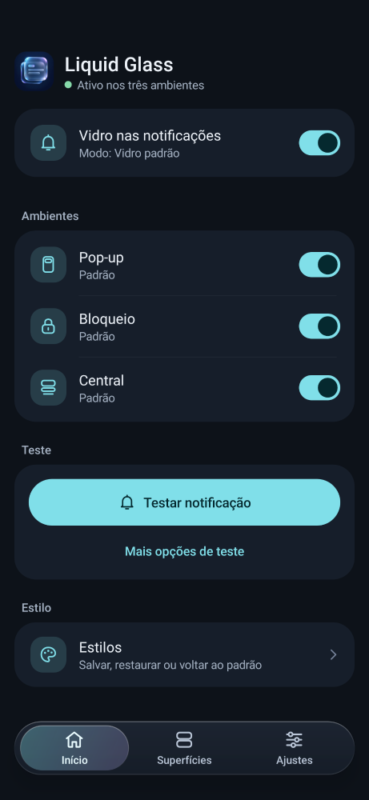 | 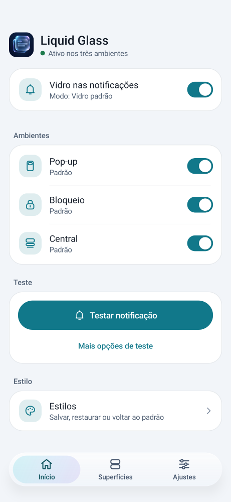 |
| 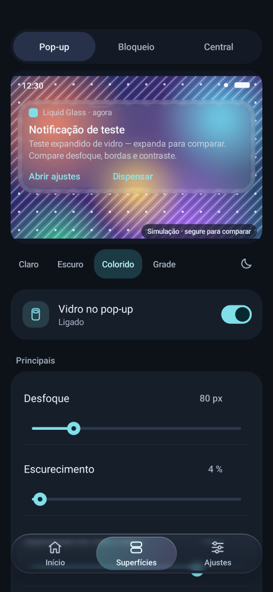 | 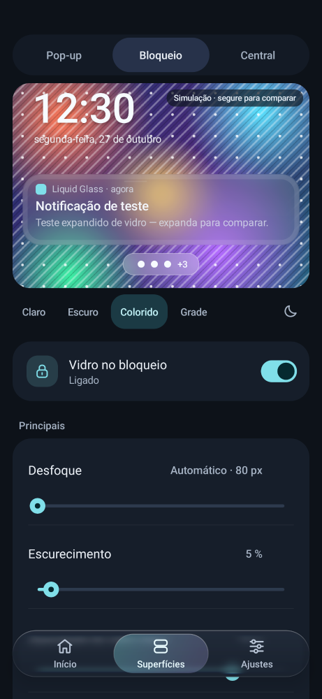 |
| 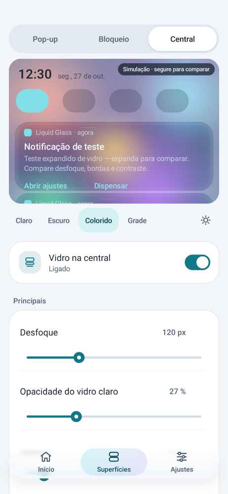 | 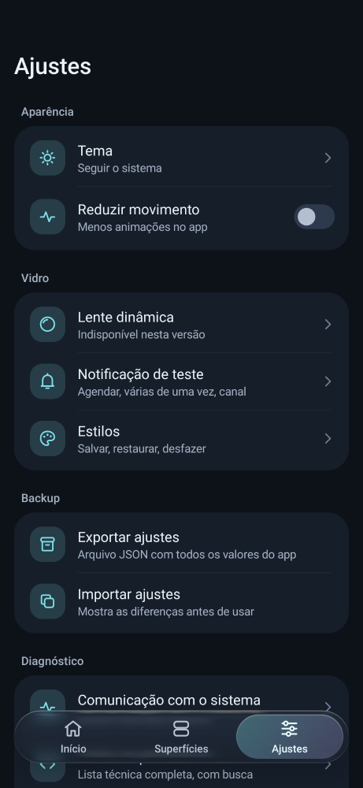 |
| 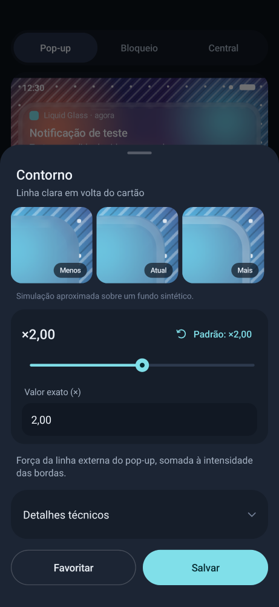 | 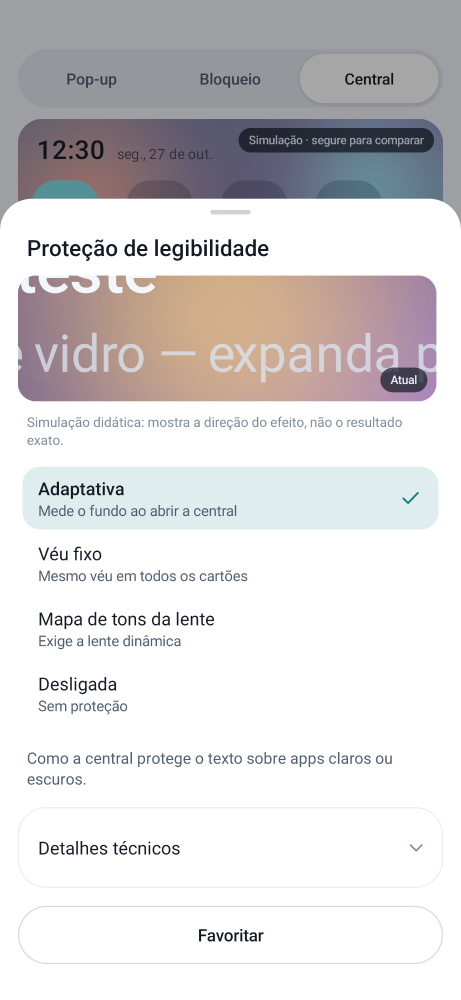 |
| 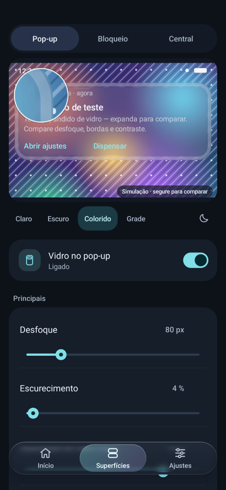 | 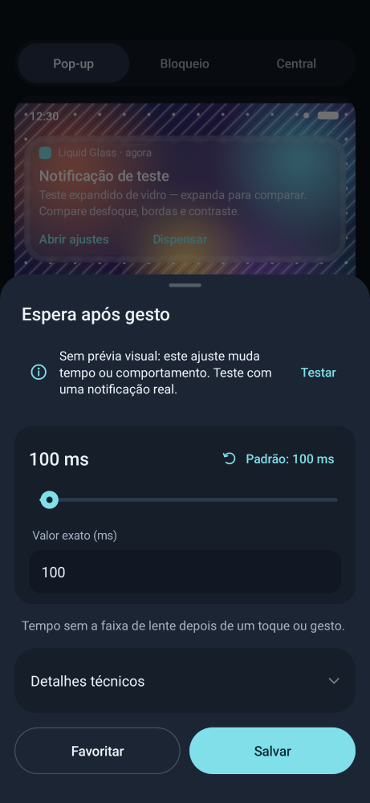 |
| 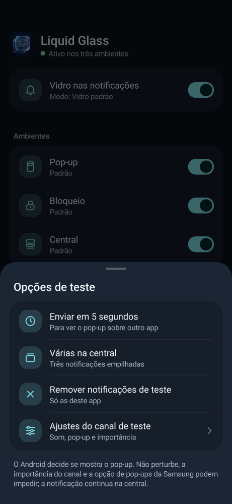 | 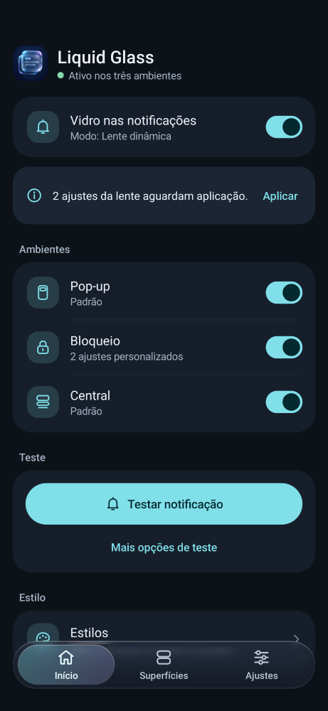 |
| 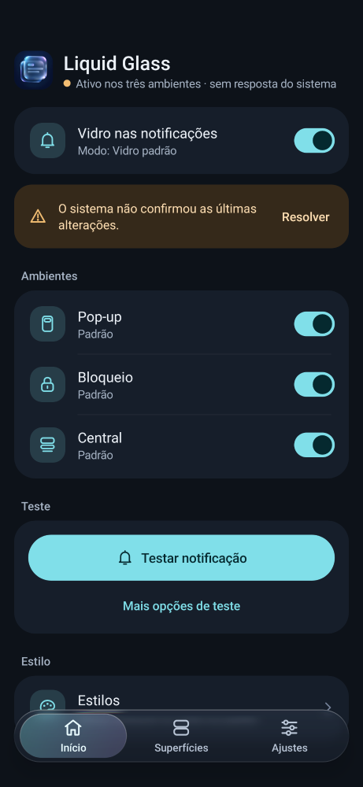 | 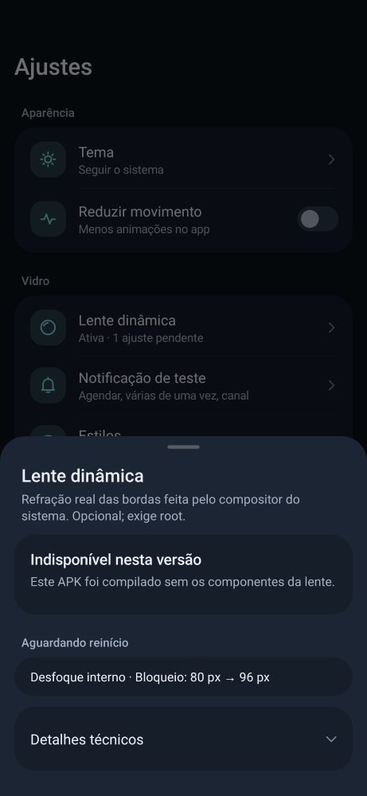 |
| 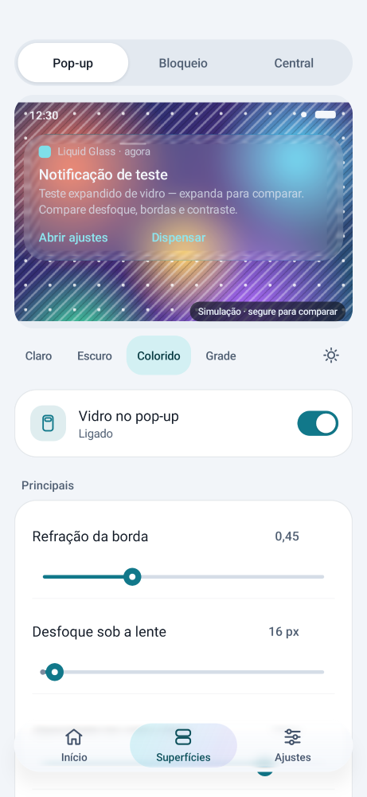 | 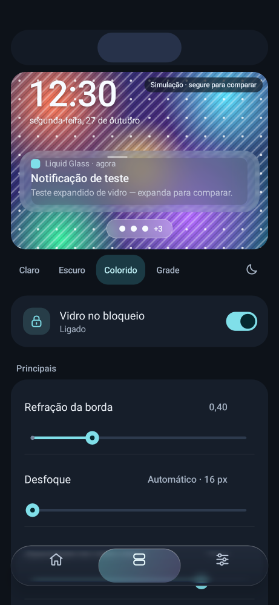 |
| 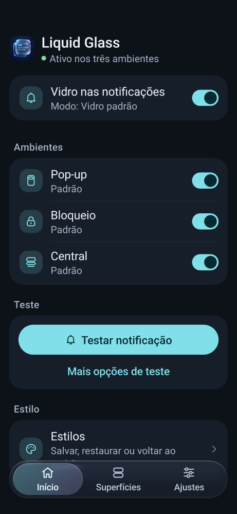 | 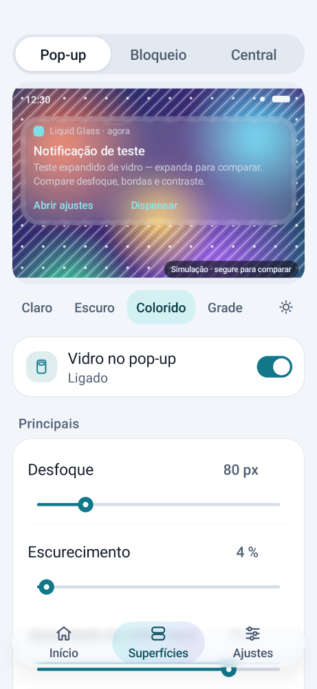 |

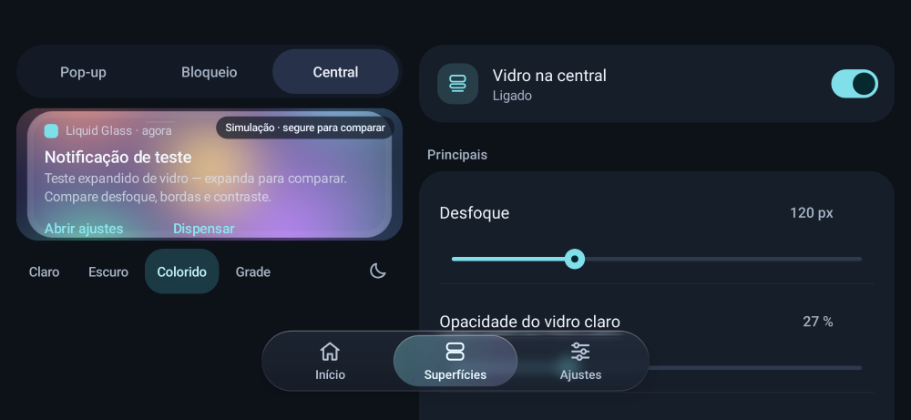

## Checklist funcional

- [x] Interruptor geral, por ambiente e por camada; camadas sem efeito no modo atual desabilitadas com motivo.
- [x] Todos os 99 parâmetros encontráveis: principais, grupos por efeito (fechados), Avançado, busca e
  "Todos os parâmetros"; estados internos não são editáveis.
- [x] Slider, campo numérico em unidade real, reset discreto, favoritos, valor automático resolvido.
- [x] Prévia: três cenas, quatro fundos, tema da amostra, segurar para comparar, lupa e trio Menos/Atual/Mais.
- [x] Notificação real: "Notificação de teste", BigText, ícone do app, ações Abrir ajustes / Dispensar;
  agora, em 5 s, várias, remover, canal; permissão negada e bloqueios descritos.
- [x] Estilos: salvar, usar com diferenças, voltar ao padrão, desfazer; exportar/importar com revisão.
- [x] Alterados fora do app: escolha explícita, sem sobrescrever.
- [x] Lente dinâmica: verificar root (só ao tocar), instalar e testar, ativar, aplicar pendentes,
  confirmação, verificação posterior, registro, remover.
- [x] Recuperação: desligar todo o vidro; reiniciar a interface do sistema (root, confirmação);
  reiniciar userspace ("soft reboot", root, confirmação com "Salvei o que estava fazendo"). O soft
  reboot é um comando fixo em `RootAccess.SOFT_REBOOT`: para o SurfaceFlinger, apaga
  `skia_shaders`, `egl_shaders` e `oulg_shaders.txt`, sobe o SurfaceFlinger e reinicia o zygote,
  desacoplado via `nohup` (o próprio app morre junto). Uma lente injetada em runtime não sobrevive ao
  reinício do compositor, então `debug.oulg.sfrefract` é limpo, exceto quando o módulo de boot
  `oulg_sf` está ativo (ele recarrega a lente a cada início do compositor).
- [x] Tema claro/escuro/sistema, reduzir movimento, fonte ampliada, paisagem, voltar preditivo, TalkBack
  (rótulos, estados de switch, slider com faixa e ações, abas da barra).

## Limitações honestas

- Nada foi testado em One UI real nesta mudança. A aparência de componentes de sistema que ainda aparecem
  (seletor de documentos, permissão de notificação) é a do Android.
- A prévia é simulação: o desfoque Samsung, o compositor e o fundo real mudam o resultado. Parâmetros de
  tempo, captura e diagnóstico não têm prévia visual e dizem isso.
- O fluxo de aplicar valores do compositor foi testado com o helper em host e com fakes; o reinício real e a
  verificação pós-reinício dependem do aparelho.
- "Lido pelo sistema" confirma a leitura dos ajustes pelo SystemUI, não que o efeito apareceu.
- A barra de vidro grava a página a cada quadro em que ela muda; em aparelhos lentos pode custar GPU.
  "Reduzir movimento" desliga as animações, não o vidro da barra.
